<div align="center">

# EV Charging Station Location with Metaheuristics

### Genetic Algorithm vs. Simulated Annealing on real city graphs — with station types and substation capacity limits


-red)


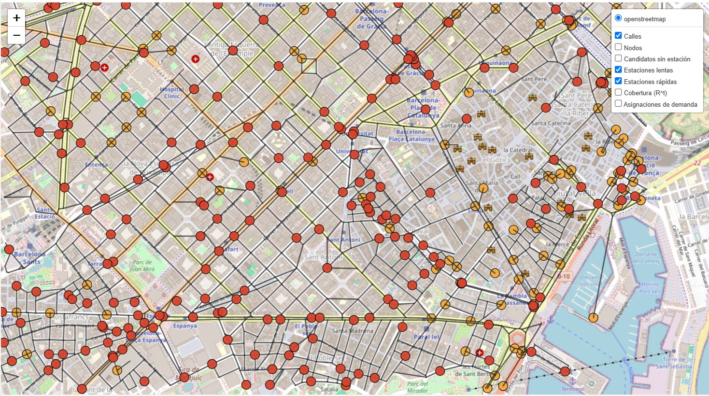

<sub>Solution found by the Genetic Algorithm in L'Eixample (Barcelona, 2,457 nodes): <b>🔴 fast</b> and <b>🟠 slow</b> stations over the real street graph. Stations cluster where demand is high.</sub>

</div>

---

## TL;DR

Where should a city install EV charging stations, and **which type** (slow or fast) at each location, so that the **maximum amount of charging demand is served** — without exceeding the **budget**, each **station's capacity**, each station's **coverage radius**, or the **power capacity of the electrical substation** that feeds it?

This repository solves that problem with two metaheuristics that share the same encoding, repair operator and fitness function, so they can be compared **fairly**:

| | |
|---|---|
| 🧬 **Genetic Algorithm (GA)** | Substation-block crossover, tournament selection, two mutation families, repair instead of penalties |
| 🔥 **Simulated Annealing (SA)** | Four reversible neighbourhood operators, four cooling schemes, calibrated on a real 2,457-node city graph |

### Headline results

| Experiment | Result |
|---|---|
| GA (one single configuration) on 8 instances (100 → 2,667 nodes) | **78.7 % – 96.4 %** of demand served vs. **62 – 73 %** for the greedy baseline |
| GA vs. SA, same 2 h wall-clock, L'Eixample (Barcelona) | **SA 99.73 %** vs. **GA 95.91 %** of total demand |
| SA with only 10,000 evaluations (~50 min) | **99.20 ± 0.24 %** (5 seeds) |
| Where SA overtakes GA | after ≈ 0.4 h (≈ 5,000–6,000 generated solutions) |

> 📄 The full write-up (in Spanish) is in [`docs/report_es.pdf`](docs/report_es.pdf) and the slide deck in [`docs/slides_es.pptx`](docs/slides_es.pptx). This README is the English summary of the whole project.

---

## Table of contents

1. [The problem](#1-the-problem)
2. [What makes this implementation particular](#2-what-makes-this-implementation-particular)
3. [Methods](#3-methods)
4. [Data and instances](#4-data-and-instances)
5. [Results](#5-results)
6. [Repository structure](#6-repository-structure)
7. [Getting started](#7-getting-started)
8. [Reproducing the experiments](#8-reproducing-the-experiments)
9. [Limitations and honest caveats](#9-limitations-and-honest-caveats)
10. [Author, course and license](#10-author-course-and-license)

---

## 1. The problem

A city is a graph $G=(V,E)$: nodes are street intersections, edges are street segments with a length. Only a subset $J \subseteq V$ of nodes can host a charging station. At each candidate we may install **nothing**, a **slow** station (cheap, low capacity, small radius: **120 m**) or a **fast** station (expensive, high capacity, large radius: **220 m**). Every candidate is wired to an electrical **substation** $g(j)\in K$ whose total capacity is limited, which prevents building only fast stations everywhere.

**Objective:** maximise the total demand served.

<table>
<tr>
<td width="50%" valign="top">

**Decision variables**

- $x_j^t \in \{0,1\}$: install a station of type $t\in\{\text{slow},\text{fast}\}$ at candidate $j$
- $y_{ij}^t \ge 0$: demand of node $i$ served by the type-$t$ station at $j$ (only if $d_G(i,j)\le R^t$, with $d_G$ computed by Dijkstra)

</td>
<td width="50%" valign="top">

**Parameters**

$w_i$ demand · $c_j^t$ cost · $cap_j^t$ station capacity · $R^t$ coverage radius · $B$ budget · $Cap_k$ substation capacity

</td>
</tr>
</table>

$$\max_{x,y}\; F(x,y)=\sum_{i\in V}\sum_{j\in J}\sum_{t\in T} y_{ij}^{t}$$

subject to

| # | Constraint | Meaning |
|---|---|---|
| 1 | $\sum_{t} x_j^t \le 1\;\;\forall j$ | At most one station type per candidate |
| 2 | $\sum_{j,t} c_j^t x_j^t \le B$ | Budget |
| 3 | $\sum_{i} y_{ij}^t \le cap_j^t x_j^t$ | A station cannot serve more than its capacity |
| 4 | $\sum_{j,t} y_{ij}^t \le w_i$ | A node cannot be served more than its demand |
| 5 | $y_{ij}^t = 0 \;\text{ if } d_G(i,j) > R^t$ | Coverage radius depends on station type |
| 6 | $\sum_{j:\,g(j)=k}\sum_t cap_j^t x_j^t \le Cap_k\;\;\forall k$ | **Substation power capacity** |
| 7 | $y_{ij}^t\ge 0$ | Non-negativity |

The search space has $3^{|J|}$ configurations (nothing / slow / fast per candidate) and the problem is a variant of the **Capacitated Maximal Covering Location Problem (CMCLP)**, which is **NP-hard** — hence metaheuristics. The original problem statement is reproduced in [`docs/problem_statement.md`](docs/problem_statement.md).

### Why the solutions look the way they do

<p align="center">
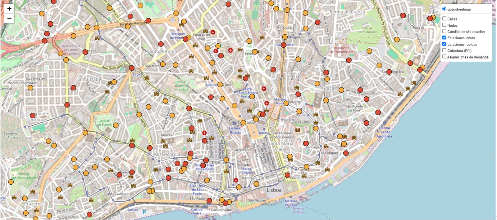
<br/><sub>Example layout in central Lisbon (🔴 fast, 🟠 slow). Demand is not uniform: high-demand hotspots need several nearby stations because a single station's capacity runs out.</sub>
</p>

- **Hotspots → clusters.** One station's capacity is exhausted quickly in high-demand areas, so several nearby installations appear.
- **Fast stations go where they absorb the most demand**; slow stations (cheaper) fill in sparse demand.
- **Substation limits force spreading.** The solution cannot simply stack fast stations in one neighbourhood.

---

## 2. What makes this implementation particular

These are the design decisions that distinguish this project from a textbook "facility location with a GA":

### 🧩 One compact encoding for both algorithms

Each solution is a vector $x=(x_1,\dots,x_{|J|})$ with $x_j\in\{0,1,2\}$ (0 = none, 1 = slow, 2 = fast). Constraint 1 is satisfied **by construction**, and GA and SA use *exactly* the same encoding, repair and fitness — so the GA-vs-SA comparison is apples to apples.

### 🔧 Repair instead of penalties

Crossover, mutation and SA moves can break the budget (2) or a substation limit (6). Instead of penalising the fitness, an infeasible solution is **repaired**: the installed station with the worst *served-demand / cost* ratio (or capacity/cost ratio in SA) among those contributing to the violated constraint is removed or downgraded. Consequences: every evaluated solution is feasible, the fitness landscape is not distorted by penalty weights, and repair cost is negligible.

### 🌊 Exact demand assignment via maximum flow

The $y$ variables do **not** need to be searched by the metaheuristic. Given a feasible $x$, the optimal $y$ is the solution of a **max-flow problem on a bipartite network** (demand nodes → open stations, restricted by radius and capacities). It is solved exactly with NetworkX, which is far cheaper than calling an LP solver on every evaluation. Search is therefore only over $x$ (the combinatorial part), and fitness is exact. Fitness results are cached for already-seen genotypes in the SA.

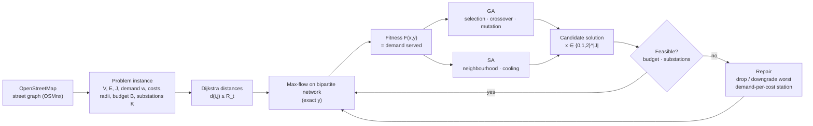

### 🏘️ Substation-block crossover (GA)

Instead of mixing genes scattered across the whole map (uniform crossover), the child inherits **the whole block of genes of each substation (neighbourhood) from one parent or the other**. This preserves coherent local configurations — and it beat uniform crossover on **every** instance tested.

### 🎲 Two complementary mutation families (GA)

- **Per-gene mutation** with probability $p_m$ (a multiple of $1/|J|$).
- **Swap-style mutation** with probability $p_{mi}$ applying up to $m$ structured moves: *move* (close a station, open another elsewhere), *type* (slow ↔ fast), *open* (open a new station if budget and substation allow). A move is retried up to 10 times if it leads to an infeasible solution.

Interesting finding: raising the per-gene mutation rate *hurts* monotonically (a random gene change tends to alter cost and then gets undone by repair), whereas structured moves help.

### 🔥 Four reversible neighbourhood operators (SA)

| Operator | Effect |
|---|---|
| **State change** | Open a station (random type) at a closed candidate, or close an open one — the only operator that changes the number of stations |
| **Swap** | Close one station and open another of random type elsewhere |
| **Type change** | Slow ↔ fast on an installed station |
| **Displacement** | Move a station (same type) to one of its *k* nearest closed candidates by shortest-path distance (symmetrised so the move is reversible) |

No operator is enough alone — the mix beats the best single operator by **> 130 fitness units**.

### 🌡️ Comparable evaluation counters and time-based cooling

- One SA iteration = one evaluated neighbour = one "generated solution" in the GA, so **convergence curves are directly comparable**.
- Four cooling schemes (geometric, linear, inverse, stepped) whose parameters are **derived automatically** so that $T$ goes exactly from $T_0$ to $T_{min}$ over the whole evaluation budget — making schemes comparable. With a **time budget**, temperature is a function of the *fraction of time used*, so every run anneals fully regardless of machine speed.

### 🗺️ Real maps, not toy graphs

Instances are built from real OpenStreetMap graphs (a village, a grid-like district, a dense historic centre and a large city centre) plus synthetic random geometric graphs for controlled scaling. Solutions are rendered as **interactive Folium maps** with toggleable layers (streets, nodes, closed candidates, slow/fast stations, coverage, demand assignments) and a generation slider to replay the GA evolution.

---

## 3. Methods

### 3.1 Genetic Algorithm

| Component | Choice |
|---|---|
| Individual | $x\in\{0,1,2\}^{|J|}$ |
| Initial population | Random, biased towards *no station* (low install probability) + a few greedy seeds; infeasible ones repaired |
| Selection | Tournament (size $k$) + elitism |
| Crossover | Per-substation block crossover (prob. $p_c$); uniform crossover available as baseline |
| Mutation | Per-gene + swap-style structured moves (move / type / open) |
| Infeasibility | Repair (no penalties) |
| Replacement | Generational with $e$ elite individuals |
| Stop | Generations, wall-clock time, or stagnation |

**Parameter study:** one-factor-at-a-time on the R-centro instance, 23 configurations × 15 seeds = **345 runs**, repeated on three other instances (R-grid, R-pueblo, S-250) to avoid instance-specific conclusions.

| Parameter | Levels tested | **Final** |
|---|---|---|
| Population size | 50, 100, 200, 1000 | **1000** |
| Tournament size | 2, 3, 5, 10 | **5** |
| Crossover probability | 0.6, 0.8, 0.9, 1.0 | **0.9** (0.8–1.0) |
| Crossover type | uniform, per-substation | **per-substation** |
| Per-gene mutation (× 1/\|J\|) | 0.5, 1, 2, 4 | **0.5** (0.5–1.0) |
| Swap-mutation probability | 0, 0.3, 0.7, 1 | **0.7** (0.3–0.7) |
| Max. moves per swap-mutation | 1, 3, 5 | **3** (1–3) |
| Elite individuals | 1, 2, 4, 10 | **4** (up to 10) |
| Greedy seeds in initial population | 0, 2, 10 | **2** (0–2) |

### 3.2 Simulated Annealing

Accepts a worse neighbour with probability $e^{\Delta/T}$, $\Delta=f(s')-f(s)<0$. $T$ is expressed in the **same units as the fitness** (units of demand served); in the target instance $D=26{,}136$, so $T_0=200$ is ≈ 0.77 % of $D$.

| Parameter | Levels tested | **Final** |
|---|---|---|
| Initial temperature $T_0$ | 10, 50, 100, 200, 10 000 | **200** |
| Cooling factor $\alpha$ | 0.8, 0.9, 0.95, 0.99, 0.999 | **0.99** |
| Cooling scheme | geometric, stepped, inverse, linear | **geometric** |
| Operators | each alone, without displacement, mix | **mix of 4** |
| Moves per neighbour | 1, 3 | **1** (1–3) |
| Neighbours per temperature $L$ | 1, 5, 25, 100 | **1** (1–5) |
| Nearest candidates $k$ (displacement) | 2, 5, 10 | **5** (2–10) |
| Initial solution | random, greedy, GA | **random** |

---

## 4. Data and instances

All instances follow **the same generation rule**:

- Candidates: $|J| \approx 35\,\%$ of $|V|$ (synthetic instances and R-centro fix it explicitly; the L'Eixample target instance uses *every* node as a candidate)
- Budget $B$ = **20 %** of the cost of opening all candidates as *fast* stations (30 % on the L'Eixample target instance)
- Coverage radii: **120 m** (slow) / **220 m** (fast)
- Demand: **concentrated in hotspots** (non-uniform)
- Total demand is scaled to **0.8 ×** the station capacity the budget can buy (`ratio_demanda_capacidad`), so capacity is tight but not hopeless; total substation capacity is drawn as 0.9–1.1 × that same bound, so substations bind when stations are concentrated

### Test instances

| ID | Type | Description | \|V\| |
|---|---|---|---|
| `S-100` | synthetic | Random geometric graph, constant mean degree and node density | 100 |
| `S-250` | synthetic | " | 250 |
| `S-500` | synthetic | " | 500 |
| `S-1000` | synthetic | " | 1,000 |
| `R-pueblo` | real | Chinchón (Madrid), 600 m radius — small town | 214 |
| `R-grid` | real | Eixample (Barcelona), 800 m — grid topology | 288 |
| `R-centro` | real | Madrid, Puerta del Sol, 1 km — dense historic centre (\|E\|=1,083, \|J\|=250, K=10, D=2,288) | 719 |
| `R-ciudad` | real | Valencia city centre, 2 km — large city | 2,667 |
| *Target* | real | **L'Eixample, Barcelona (2 km)** — used for SA calibration and the 2 h GA-vs-SA comparison (\|V\|=2,457, \|E\|=3,873, D=26,136) | 2,457 |

> **Reproducibility note.** Synthetic instances are fully deterministic (fixed seed). Real graphs are **downloaded from OpenStreetMap at run time** with OSMnx (cached locally in `cache_osmnx/`); node counts can drift slightly if OSM data has changed since the experiments were run. Graphs are re-ordered canonically (nodes/edges sorted by id) so the instance does not depend on the order OSM returns elements.

Instance definitions live in [`src/instancias.py`](src/instancias.py); experimental design (seeds, budgets, factor levels) in [`src/config_experimentos.py`](src/config_experimentos.py).

---

## 5. Results

### 5.1 Genetic Algorithm

#### Parameter study (R-centro, 15 seeds per level)

<p align="center">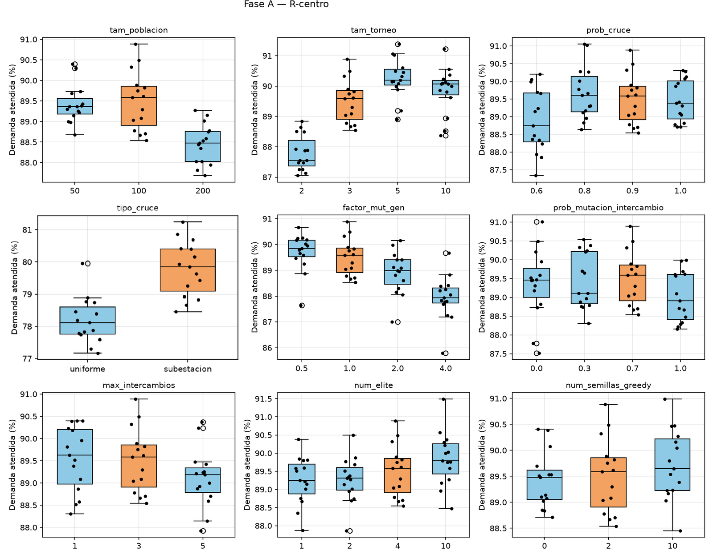</p>

Main findings:

1. **Tournament size is the most influential parameter.** Size 2 gives too little selection pressure; 5 is best on all four instances (≈ +1 % over size 3); 10 does not improve on 5.
2. **Population size is instance-dependent** (200 is worst on three instances, best on S-250), but 100 is the most robust — it is never the worst level.
3. **Per-gene mutation hurts** as it increases; **structured swap-mutation helps** versus none.
4. **Substation crossover beats uniform crossover** on every instance — preserving a neighbourhood's configuration matters.
5. **Elitism and greedy seeding have small effects**; the GA does not depend on the greedy heuristic.

#### Same conclusions on other instances

<p align="center">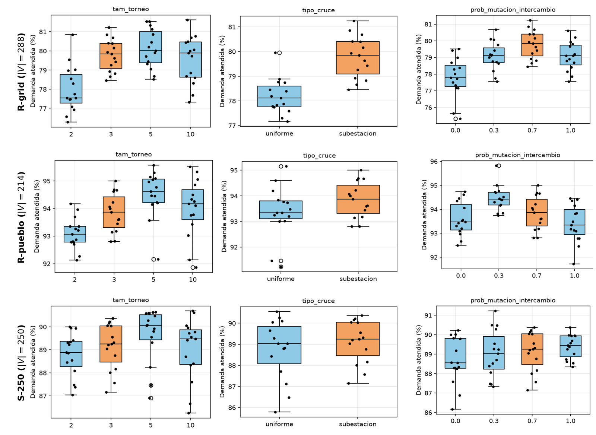</p>

#### Final configuration across all instances (20,000 solutions)

<p align="center">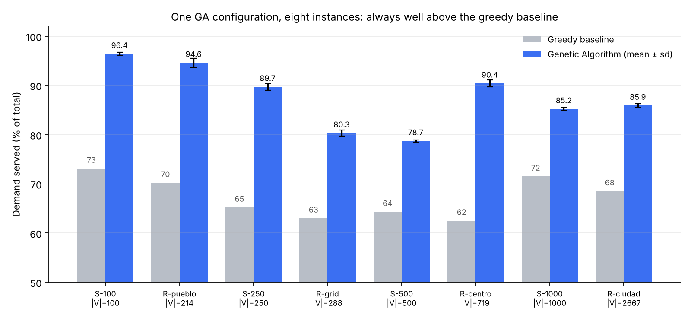</p>

| Instance | \|V\| | Greedy (%) | **GA (%)** | Time (s) | Slow / Fast | Budget used (%) | Avg. substation use (%) |
|---|---:|---:|---:|---:|---:|---:|---:|
| S-100 | 100 | 73.1 | **96.4 ± 0.3** | 45 | 9 / 4 | 99 | 71 |
| R-pueblo | 214 | 70.2 | **94.6 ± 0.9** | 124 | 12 / 12 | 100 | 89 |
| S-250 | 250 | 65.2 | **89.7 ± 0.7** | 134 | 16 / 13 | 100 | 90 |
| R-grid | 288 | 63.0 | **80.3 ± 0.6** | 126 | 12 / 17 | 100 | 90 |
| S-500 | 500 | 64.3 | **78.7 ± 0.2** | 378 | 32 / 25 | 100 | 86 |
| R-centro | 719 | 62.5 | **90.4 ± 0.7** | 520 | 47 / 35 | 100 | 86 |
| S-1000 | 1,000 | 71.5 | **85.2 ± 0.3** | 852 | 57 / 53 | 100 | 90 |
| R-ciudad | 2,667 | 68.5 | **85.9 ± 0.4** | 2,382 | 118 / 159 | 100 | 86 |

The budget is essentially always exhausted, so **budget — not coverage — is the binding constraint**, and substations are used at 86–90 % on most instances.

#### Convergence and scaling

<p align="center">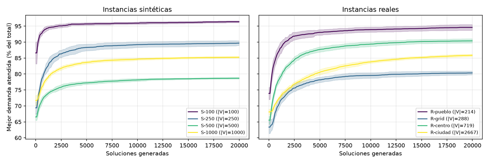</p>

All curves share a pattern: a fast jump in the first ~2,500 generated solutions followed by ever-slower improvement. Small and medium instances are close to their final fitness after ~5,000 solutions; large ones need more.

<p align="center">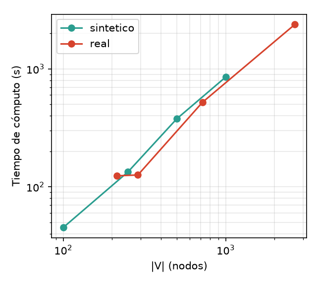</p>

Runtime grows roughly linearly with graph size (≈ 45 s for 100 nodes → ≈ 2,400 s for 2,667 nodes) in both synthetic and real graphs.

---

### 5.2 Simulated Annealing

#### Calibrating $T_0$ and $\alpha$ (5×5 grid, 5 seeds, 10,000 evaluations, target instance)

<p align="center">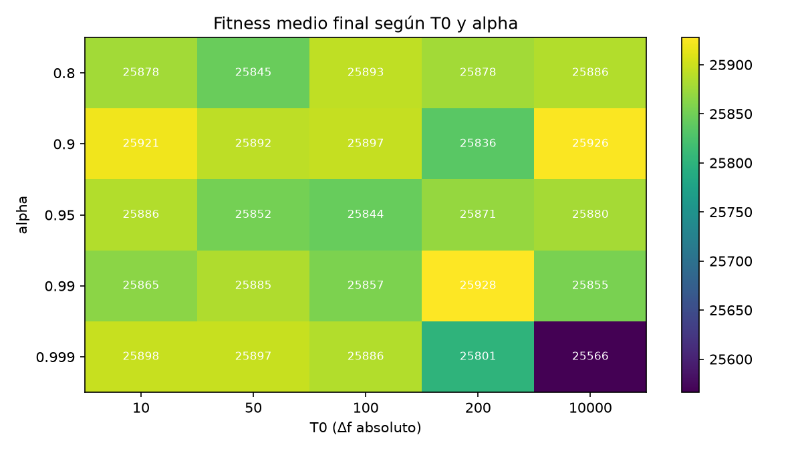</p>

- The result is **barely sensitive** to either parameter: 23 of 25 configurations land between **98.85 % and 99.20 %** of the demand — the spread (92 units) is comparable to the seed-to-seed standard deviation.
- The only clear failure is **slow cooling from a high temperature** ($\alpha=0.999$, $T_0\ge 200$): the budget is burnt on near-random walk (99.8 % of worse neighbours accepted when $T_0=10{,}000$) and the final fitness falls to 25,566.
- **Chosen: $T_0=200$, $\alpha=0.99$** — best mean fitness (99.20 % of $D$) while keeping a moderate exploration phase (44.6 % initial acceptance of worsening moves).

<p align="center">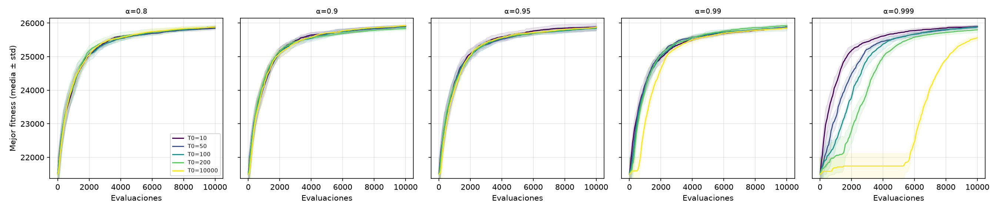<br/><sub>Best fitness vs. evaluations — one panel per α, one curve per T₀.</sub></p>

#### Cooling schemes, neighbourhood and starting solution (preliminary study, synthetic |V|=500)

<table>
<tr>
<td width="33%">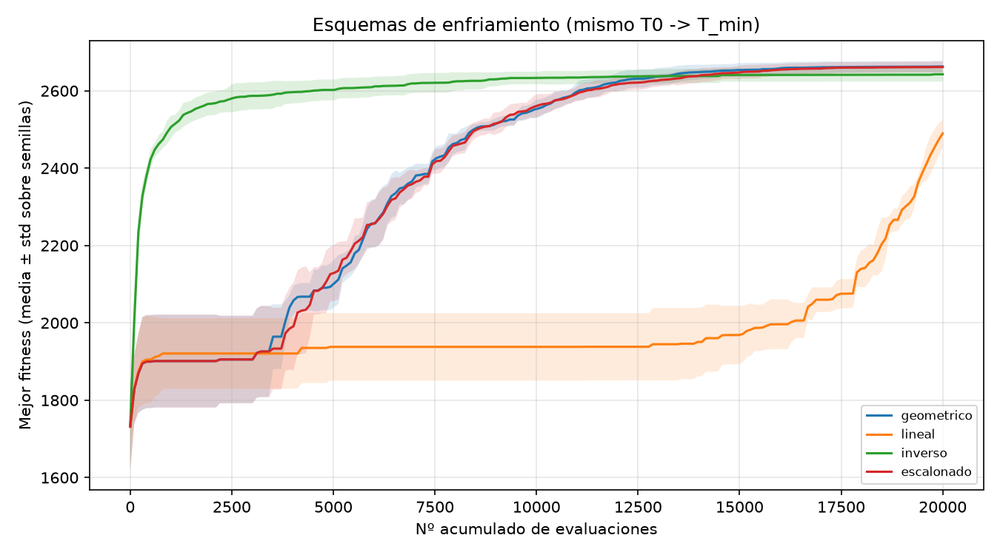<br/><sub><b>Cooling.</b> Geometric ≈ stepped (best); inverse converges prematurely; linear is clearly worst.</sub></td>
<td width="33%">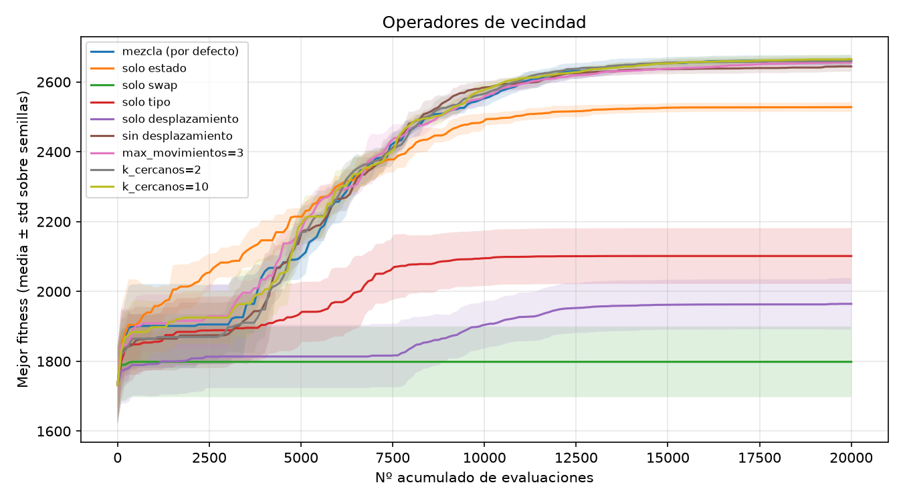<br/><sub><b>Neighbourhood.</b> No single operator suffices; the mix wins by > 130 units.</sub></td>
<td width="33%">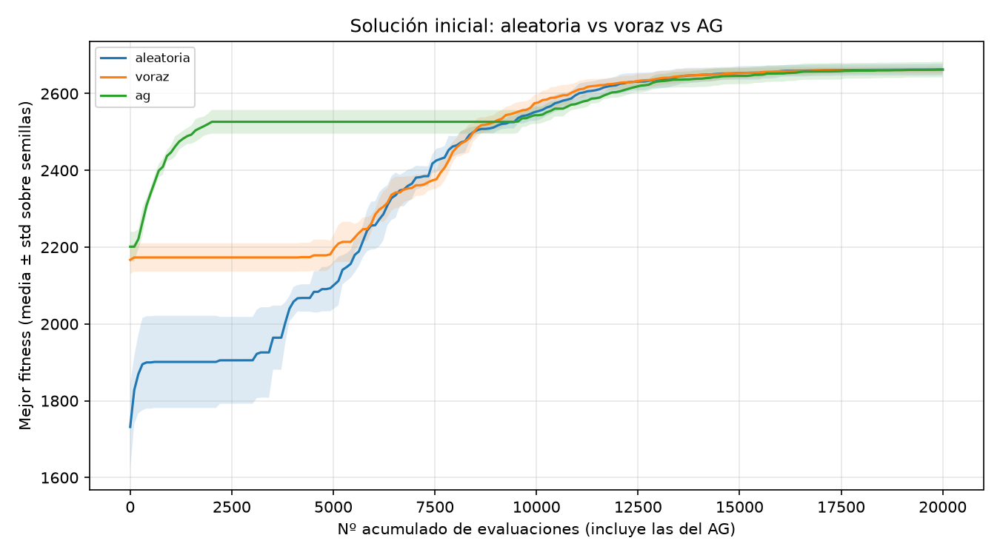<br/><sub><b>Initial solution.</b> Random, greedy and GA starts end up equivalent — the hot phase erases the starting point.</sub></td>
</tr>
</table>

| Cooling scheme | Mean fitness ± σ |
|---|---|
| Geometric | 2662.8 ± 14.8 |
| Stepped | 2661.5 ± 14.3 |
| Inverse | 2642.7 ± 18.6 |
| Linear | 2489.8 ± 34.4 |

#### Final SA runs on the target instance

| Budget | Demand served |
|---|---|
| 10,000 evaluations (~50 min), 5 seeds, random start (~75 % initially) | **99.20 ± 0.24 %** of $D$ |
| 2 h (24,893 evaluations, 1 run) | **99.73 %** of $D$ |

A 2 h run shows **three temperature-driven phases**: (1) *exploration* — best fitness stays at the initial value while the current solution wanders; (2) *descent* — best fitness climbs from 84.5 % to ≈ 98 %; (3) *refinement* after the first hour — essentially greedy, 99.0 % → 99.6 % → 99.73 % at 1 h / 1.5 h / 2 h.

---

### 5.3 GA vs. SA at equal compute time (2 hours, L'Eixample)

<p align="center">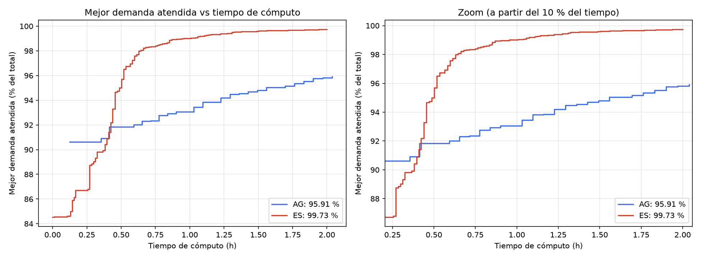</p>

| | Final fitness | % of D | Solutions generated | Time (h) | 0.5 h | 1 h | 1.5 h | 2 h |
|---|---:|---:|---:|---:|---:|---:|---:|---:|
| **GA** (pop. 1,000) | 25,067 | 95.91 | 30,880 | 2.04 | 91.85 | 93.05 | 94.80 | 95.82 |
| **SA** | **26,066** | **99.73** | 24,893 | 2.00 | 95.01 | 99.01 | 99.60 | 99.73 |

<p align="center">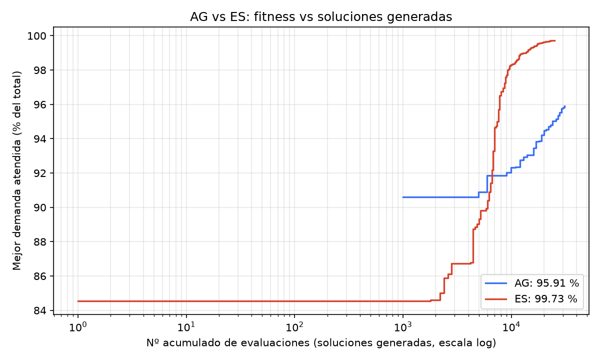</p>

- The **GA starts better** — its initial population (with greedy seeds and the best of 1,000 individuals) already serves 90.6 % — whereas SA starts from a random solution at 84.5 % and does not improve its best-so-far until its temperature falls.
- **SA overtakes the GA at ≈ 0.4 h** and pulls away: +3.2 points at 0.5 h, almost +6 at 1 h, and ≈ **1,000 more units of demand** at the end.
- **SA saturates after the first hour; the GA is still improving** when time runs out, so it cannot be said to have converged.
- The ~1,000-unit gap is an order of magnitude larger than the seed-to-seed dispersion measured elsewhere, which suggests the SA advantage at long budgets is real (see caveats below).

**Takeaway:** on this instance, **SA is preferable unless the time budget is very short.** Its advantage seems to come from the exploration phase followed by local refinement with a single-move neighbourhood.

---

## 6. Repository structure

```
.
├── README.md
├── requirements.txt
├── LICENSE
├── docs/
│   ├── report_es.pdf                 # Full report (Spanish)
│   ├── slides_es.pptx                # Presentation (Spanish)
│   ├── problem_statement.md          # Formal problem statement (English)
│   ├── code_guide.md                 # Module-by-module guide + ES↔EN glossary + all parameters
│   ├── ga_exploratory_notes_es.txt   # Raw notes from early GA exploration (Spanish)
│   └── assets/                       # Figures used in this README
├── src/                              # All Python modules (flat layout)
│   ├── problema.py                   # Problem definition + synthetic graph/instance generator
│   ├── grafo_real.py                 # Real city graphs from OpenStreetMap (OSMnx)
│   ├── distancias.py                 # Dijkstra distances node → candidate
│   ├── codificacion.py               # Encoding, decoding, repair
│   ├── fitness.py                    # Exact demand assignment via max-flow
│   ├── algoritmo_genetico.py         # GA
│   ├── algoritmo_es.py               # Simulated Annealing (+ neighbourhood, cooling schemes)
│   ├── visualizacion.py              # Plots, interactive Folium maps, generation explorer
│   ├── visualizacion_es.py           # SA-specific plots
│   ├── instancias.py                 # The 8 benchmark instances
│   ├── config_experimentos.py        # Experimental design (seeds, budgets, levels)
│   ├── main.py / main_es.py          # Single-run entry points (GA / SA)
│   ├── experimentos.py / analisis.py # GA parameter study + analysis
│   ├── experimentos_es.py            # SA experiments (T0×α, schemes, operators, init)
│   ├── run_ag_2h.py / run_es_2h.py   # 2-hour runs with checkpoints
│   └── comparar_2h.py                # GA vs SA comparison plots
├── hpc/                              # SLURM job scripts used on the UPV cluster
└── results/
    ├── sa_calibration/               # T0×α sweep: CSV + figures
    └── ga_vs_sa_2h/                  # 2 h comparison: CSV, figures, raw run histories (.pkl)
```

> Identifiers and comments in the code are in **Spanish** (the course language). [`docs/code_guide.md`](docs/code_guide.md) contains a Spanish→English glossary of modules, classes and parameters.

---

## 7. Getting started

```bash
git clone https://github.com/<your-user>/ev-charging-metaheuristics.git
cd ev-charging-metaheuristics
python -m venv .venv && source .venv/bin/activate
pip install -r requirements.txt
cd src
```

**Run the GA** (edit the `PARAMETERS` block at the top of `main.py`; to reproduce the report set `CONFIG_AG` to the [final configuration](#31-genetic-algorithm) — population 100, tournament 5, elite 4, etc.):

```bash
python main.py
```

**Run Simulated Annealing on the same instance** (`main_es.py` imports the problem definition from `main.py`, so both solve exactly the same instance):

```bash
python main_es.py
```

> ⚠️ `main.py` defaults to a **real graph** (`USAR_GRAFO_REAL = True`, L'Eixample), which needs internet access to OpenStreetMap and takes a while. For a quick offline try, set `USAR_GRAFO_REAL = False` to use a small synthetic graph.

**Minimal programmatic example** (synthetic instance, runs in seconds):

```python
from problema import generar_grafo_sintetico, generar_parametros_problema
from distancias import calcular_distancias
from algoritmo_genetico import ConfiguracionAG, ejecutar_algoritmo_genetico
from algoritmo_es import ConfiguracionES, ejecutar_enfriamiento_simulado

graph = generar_grafo_sintetico(n_nodos=100, escala_metros=1200.0, semilla=1)
problem = generar_parametros_problema(graph, n_candidatos=35, n_subestaciones=3, semilla=1)
dist = calcular_distancias(problem)
total = sum(problem.demanda.values())

ga = ejecutar_algoritmo_genetico(
    problem, dist, ConfiguracionAG(tam_poblacion=30, num_generaciones=20, semilla=1, verbose=False))
sa = ejecutar_enfriamiento_simulado(
    problem, dist, ConfiguracionES(T0=100, T_min=0.01, normalizacion="ninguna",
                                   max_evaluaciones=1500, semilla=1, verbose=False))

print(f"GA: {100 * ga.mejor_fitness / total:.1f}% of demand")
print(f"SA: {100 * sa.mejor_fitness / total:.1f}% of demand")
```

Outputs of a full run: convergence / diversity / resource-usage plots, a solution plot, an interactive Folium map (with toggleable layers) and a generation-slider explorer.

---

## 8. Reproducing the experiments

All commands run from `src/`. Heavy phases were run on a SLURM cluster (scripts in [`hpc/`](hpc/) — paths and queues are specific to the UPV cluster, adapt them to yours).

| Experiment | Command |
|---|---|
| List GA experiment phases without running | `python experimentos.py --listar` |
| GA phase A: one-factor-at-a-time study (345 runs) | `python experimentos.py --fase A --workers 8 --salida resultados` |
| GA phases B / C / D: final config on all instances / key factors elsewhere / problem-parameter sensitivity | `python experimentos.py --fase B` (or `C`, `D`) |
| Analyse GA results (plots + report folder) | `python analisis.py --res resultados --out informe` |
| SA: T₀ × α sweep | `python -u experimentos_es.py barrido` |
| SA: other experiments (schemes, init, operators, AG vs SA) | `python experimentos_es.py` (select experiments in its `PARAMETERS` block) |
| 2 h GA run (pop. 1,000) | `python -u run_ag_2h.py --horas 2 --poblacion 1000` |
| 2 h SA run | `python -u run_es_2h.py --T0 200 --T_min 0.001 --horas 2` |
| GA vs SA comparison figures | `python comparar_2h.py --carpeta salidas/comparacion_2h` |

The raw histories of the 2 h runs are in `results/ga_vs_sa_2h/*.pkl`, so you can regenerate the comparison without recomputing:

```bash
python comparar_2h.py --carpeta ../results/ga_vs_sa_2h
```

> ⚠️ `.pkl` files are Python pickles — only load pickles from sources you trust (these were produced by the author's own runs).

---

## 9. Limitations and honest caveats

- **GA vs SA is one run per algorithm on one instance.** The 2 h comparison uses a single seed, a single instance (L'Eixample) and a GA population (1,000) that differs from the tuned one (100). The ~1,000-unit gap is much larger than the measured seed-to-seed spread, so the SA advantage looks real — but it should be confirmed with several seeds and instances.
- **The GA was still improving at 2 h**, so with more time the gap could narrow.
- **Different calibration budgets.** SA's $T_0$/$\alpha$ were tuned on the target instance, while its cooling-scheme, neighbourhood and initial-solution studies were done on a smaller synthetic instance (conclusions on schemes and operators are not expected to depend on scale).
- **SA temperature units.** The report uses *absolute* fitness units for $T$ (e.g. $T_0=200$). The code also supports normalising $\Delta f$ by the total demand (`normalizacion="demanda_total"`); `main_es.py` is set to absolute units to match the report.
- **Real graphs depend on live OpenStreetMap data**, so exact node counts and fitness values may differ slightly from the published numbers.
- **Problem-parameter sensitivity** (budget fraction, radii scale, hotspot fraction, substation count — phase D in `config_experimentos.py`) is implemented but not analysed in the report.
- Demand is a **synthetic estimate** (hotspot model), not measured charging data.

---

## 10. Author, course and license

**Carlos Broch Cubedo** — MSc in Artificial Intelligence, Pattern Recognition and Digital Imaging (IARFID), Universitat Politècnica de València.
Course: *Metaheuristic Techniques* (Técnicas Metaheurísticas), DSIC-UPV, 2026–27.

Released under the [MIT License](LICENSE). Map data © [OpenStreetMap](https://www.openstreetmap.org/copyright) contributors.

### Built with

[NetworkX](https://networkx.org/) · [OSMnx](https://osmnx.readthedocs.io/) · [NumPy](https://numpy.org/) · [Matplotlib](https://matplotlib.org/) · [Folium](https://python-visualization.github.io/folium/)
